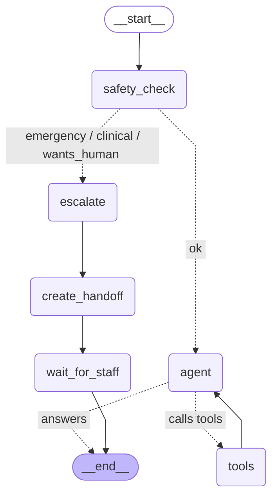

# Agent graph

The LangGraph chat agent in `api/app/agent/graph.py`, as built for production.
Dotted arrows are conditional (the router or the safety check decides).

| Node | What it does |
|---|---|
| `safety_check` | Regex rules, then the LLM: emergency, clinical, wants_human or ok |
| `escalate` | Fixed reply first (the 911 message never waits) |
| `create_handoff` | AI summary for staff, handoff row, conversation status `handoff` |
| `wait_for_staff` | Pauses (`interrupt`) until staff close the handoff or the patient leaves it, then resumes |
| `agent` | The LLM: picks tools (at most 4 calls a turn), then answers only from their results, citing them |
| `tools` | Runs the 8 read-only tools for the logged-in patient (id from the token, never the LLM): appointments, documents, labs, record lists, record search, policy search, coverage, open times |

Generated by `cd api && uv run python -m app.agent.draw`; don't edit by hand.
