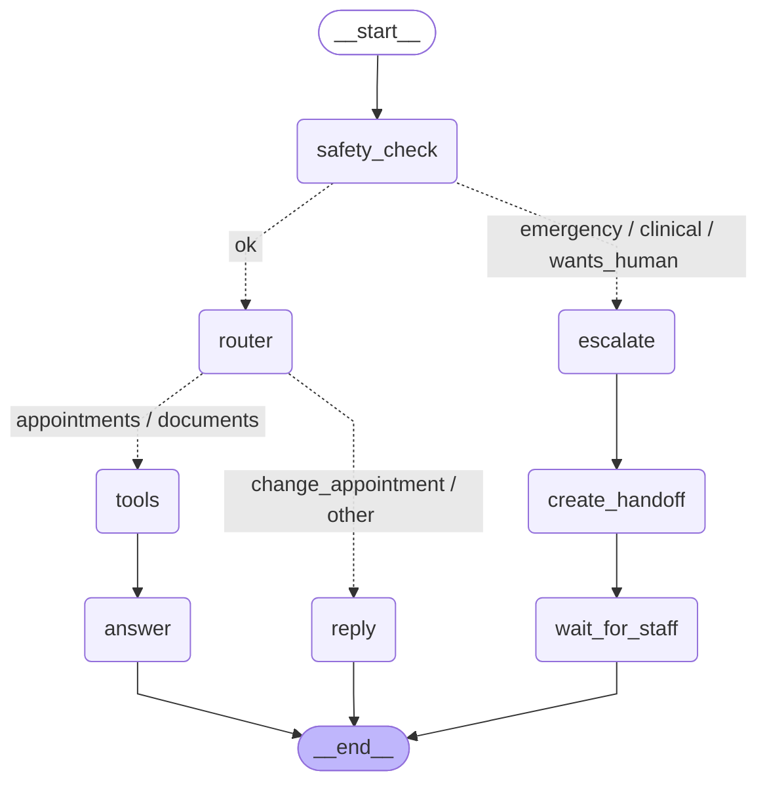

# Agent graph

The LangGraph chat agent in `api/app/agent/graph.py`, as built for production.
Dotted arrows are conditional (the router or the safety check decides).

| Node | What it does |
|---|---|
| `safety_check` | Regex rules, then the LLM: emergency, clinical, wants_human or ok |
| `escalate` | Fixed reply first (the 911 message never waits) |
| `create_handoff` | AI summary for staff, handoff row, conversation status `handoff` |
| `wait_for_staff` | Pauses (`interrupt`) until staff close the handoff, then resumes |
| `router` | LLM picks appointments, documents, change_appointment or other |
| `tools` | Read-only SQL for the logged-in patient (id from the token, never the LLM) |
| `answer` | LLM answers only from the tool's records, streamed |
| `reply` | Fixed text: use the Appointments tab, or what the assistant can help with |

Generated by `cd api && uv run python -m app.agent.draw`; don't edit by hand.
